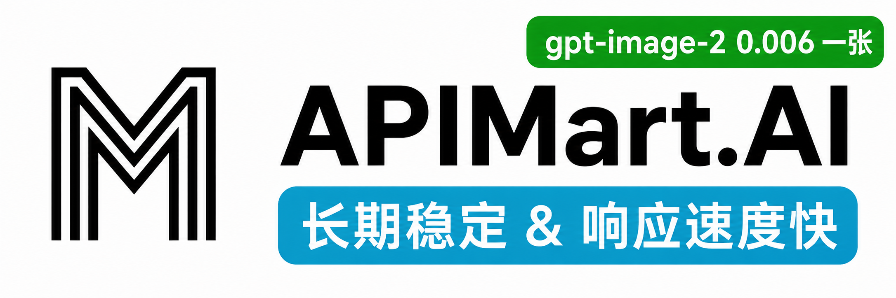

# CLI Proxy API

[English](README.md) | 中文 | [日本語](README_JA.md)

如果您想在您的桌面使用 CLIProxyAPI，我们推荐您使用我们的 [EasyCLIProxyAPI](https://github.com/router-for-me/EasyCLIProxyAPI) 桌面客户端，该客户端提供了图形化的配置界面、自动更新、系统托盘集成、一键启动/关闭 CLIProxyAPI 服务等功能。

CLIProxyAPI 是一个为 CLI 提供 OpenAI/Gemini/Claude/Codex/Grok 兼容 API 接口的代理服务器。

**WorkBuddy 双站点**：管理页“OAuth 登录”分别提供 **WorkBuddy 国内站**（`workbuddy`，`copilot.tencent.com`）和 **WorkBuddy 国际站**（`workbuddy-ai`，`www.workbuddy.ai`）。点击对应登录按钮，在浏览器完成授权后，CPA 自动轮询并保存账号，无需粘贴回调地址或开放额外端口。两个站点独立保存凭据，支持多账号调度及过期前自动刷新；企业账号保留企业身份。命令行也可用 `--workbuddy-login` 或 `--workbuddy-ai-login`，服务器环境可加 `--no-browser` 后在自己的浏览器打开打印的授权链接。

登录后按账号读取 `/v3/config` 的 CLI 模型目录及上下文、思考等级和图片输入能力；目录暂不可读时使用上次目录或对应站点的内置目录。模型通过现有 Chat Completions、Responses、Claude、Gemini 接口调用。WorkBuddy 上游只接受流式请求，CPA 为非流式客户端聚合 SSE，保留思考文本、工具调用和用量；工具名称会在往返时恢复。账号文件可配置 `prefix`（例如 `workbuddy-ai`），通过 `workbuddy-ai/<模型 ID>` 明确选用该站点。上游账号限制和额度错误按现有调度策略处理。

“配额管理”和认证文件卡片支持两个站点的额度查询，显示套餐、剩余积分、积分总量和已用积分；企业账号无个人积分包时读取企业额度，并显示上游提供的重置时间。查询前刷新即将过期的令牌并保存轮换凭据，浏览器只接收额度数据。没有有效积分包时明确提示，不将缺失数据当作无限额度。

WorkBuddy 两个站点的推理响应返回业务码 `6004` 时，CPA 按**整账号临时冷却**处理，不仅暂停当前模型；返回业务码 `6000` 时，只冷却触发限速的认证文件和对应模型，同一认证文件上的其他模型仍可正常调度。普通 JSON（包括 HTTP 200 中的业务错误）和 SSE 错误均会识别；从提示中的日期、时间及 `UTC+8` 等偏移解析重置时刻，冷却期间改用同一调度池的其他可用账号或模型，到期自动重新参与调度。如果再次超限，则按新的响应继续冷却。没有有效重置时间时使用 `Retry-After` 或现有配额退避，不猜测固定午夜。已向客户端输出内容的流不会在另一账号上重放。

此类明确的上游用量限制不受“忽略冷却”开关绕过，也不会因“额度耗尽自动停用”变为永久停用。账号和配置重载保留有效冷却；配置了冷却状态存储时，服务重启会恢复未到期限制。手动停用、正常/降级池归属及其他账号保持不变；冷却到期不会自动启用手动停用的账号。

接入依据：[Magpie](https://github.com/yetone/magpie) 及其 [WorkBuddy 官方社区插件](https://github.com/magpie-community/plugins/tree/main/packages/workbuddy)。CPA 原生实现协议和认证流程，不需要安装该插件或运行 Magpie。

**管理页对话工作区**：登录后点击侧边栏“对话”，在 CPA 主内容区创建、重命名、搜索和切换实例共享的会话，页面沿用管理面板的主题与导航。模型和思考等级选择位于输入框底部的上传按钮旁，只列出当前已启用认证文件实际注册的文本模型，排除停用账号、仅配置的供应商模型和本地假模型；认证状态变化后列表自动刷新，已失效的历史模型需要重新选择。每个会话可独立启动或停止生成，多会话并行；任务由服务器持有，切换页面、关闭对话工作区或刷新浏览器不会取消。停止按钮只取消当前会话。模型需要支持函数工具调用才能完成文件与终端操作。

普通问答、解释和代码示例直接在聊天中回复，不要求写文件或执行脚本。任务需要时，AI 可调用文件列表、读取、写入、删除、文本搜索和 Docker 终端工具，界面显示执行过程与结果，完成后回到文字回复。输入框提供文件上传，右侧工作区提供文件预览和下载；二进制产物原样下载，预览只显示文本，不执行 AI 生成的 HTML。Markdown 由随二进制离线嵌入的 Marked 解析、DOMPurify 清理，图标使用 Lucide。所有聊天、文件与事件接口均复用管理鉴权，支持 `/v0/management/agent/*` 和 `/v8/management/agent/*`，不向普通 API Key 开放。

会话默认保存在配置文件旁的 `runtime/agent-workspace/conversations/`，文件在 `runtime/agent-workspace/workspaces/<会话 ID>/`；可用 `CPA_AGENT_WORKSPACE_DIR` 指定持久化目录。重启后保留历史与文件，重启时未完成的回合标记为“已中断”，不会自动重放命令。删除对话先取消模型与命令并等待退出，再清理对应容器、会话记录和整个工作区。全部管理登录共享这些会话。

终端需要 CPA 服务账号可访问的 Docker CLI/daemon，以及预先拉取的沙箱镜像。默认镜像为 `node:22-bookworm`，可用 `CPA_AGENT_SANDBOX_IMAGE` 更换为包含所需 Python、Go 或其他工具的自备镜像；CPA 不自动拉取镜像、不自动授予系统权限。每个会话独立容器，只挂载自身目录到 `/workspace`，使用服务进程 UID/GID（Windows 使用 1000），禁用网络、丢弃 capabilities、启用 `no-new-privileges` 和只读根文件系统，限制为 1 CPU、512 MiB 内存、128 个进程和 64 MiB 临时目录。依赖需预装在镜像或上传到工作区，禁网模式不能从 npm/pip 在线下载。Docker 不可用时聊天与文件工具仍可用，终端状态和工具调用明确报错。

单次发送最多 12 个工具回合；达到上限后追加一次禁用工具的文字总结请求，不继续执行工具。工具文本读写和输出限 1 MiB，单文件上传限 32 MiB，下载流式发送。聊天历史使用完整上下文，超出模型上下文上限时需要新建会话。工作区磁盘配额由部署卷管理，不将内存限制视为磁盘限制。CPA 自身容器化部署时，工作区绑定路径必须与 Docker daemon 看到的宿主机路径一致。

内置预估费用表已按 2026-09-23 核对的 [OpenAI 价格表](https://developers.openai.com/api/docs/pricing)、[GPT-6.1 Sol](https://developers.openai.com/api/docs/models/gpt-6.1-sol)、[GPT-6 Sol](https://developers.openai.com/api/docs/models/gpt-6-sol) 和 [GPT-6 Luna](https://developers.openai.com/api/docs/models/gpt-6-luna) 文档加入这些模型的 Standard 价格。单位为美元 / 百万 tokens，Codex 和 OpenAI 兼容渠道使用相同的新增费率：

| 模型 | 单次请求输入总量 | 输入 | 缓存读取 | 缓存写入 | 输出 |
| --- | --- | ---: | ---: | ---: | ---: |
| `gpt-6-sol` | ≤272,000 | 2.00 | 0.20 | 2.50 | 10.00 |
| `gpt-6-sol` | >272,000 | 4.00 | 0.40 | 5.00 | 15.00 |
| `gpt-6.1-sol` | ≤272,000 | 2.00 | 0.10 | 2.50 | 10.00 |
| `gpt-6.1-sol` | >272,000 | 4.00 | 0.20 | 5.00 | 15.00 |
| `gpt-6-luna` | ≤272,000 | 0.10 | 0.01 | 0.125 | 0.50 |
| `gpt-6-luna` | >272,000 | 0.20 | 0.02 | 0.25 | 0.75 |

阶梯按**每次请求的输入总量（含缓存读写）**选择，超过门槛后整笔请求使用长上下文费率，不是仅对超出部分加价；输出 tokens 不参与选档，推理 tokens 已包含在输出计数中，不重复计费。Sol/Luna 不再按 Astra 的价格估算，其他模型费率保持原样。本地账本仍按 Standard 价格估算，不自动叠加 Fast、Flex、Batch 或区域处理系数，也不代表订阅账号的实际扣款；新价格不追溯重算此前累计的费用。

认证文件账号支持 **正常 / 降级 / 停用** 三态，可在账号卡片或“账号调度”悬浮窗内调整。正常账号只参与主端口调度，降级账号只参与“降级账号 API 端口”的调度，停用账号不参与任何调度；两个池不会互相兜底，共用原有 API Key、模型映射、重试、并发限制及用量统计。降级标记保存在认证文件中，重启后保留。

认证文件卡片的“成功 / 失败”总数支持悬停查看该账号全部已记录请求的分模型 Token 累计，列为模型 ID、总输入、缓存输入、缓存率和输出。缓存输入按缓存读取量统计，缓存率使用该模型累计缓存输入除以累计总输入；总输入包含缓存读写，输出包含上游计入的推理量。统计不受状态条时间窗口或跨日影响，服务重启及手动重置该账号统计时清空；失败但无 usage 的模型显示零值。浮窗沿用状态条配色，所有字段单行显示，窄屏可横向滚动，支持键盘聚焦和触屏点击。

本分支默认的 Codex2API 调度（兼容配置名 `round-robin`）采用 **剩余额度平滑加权轮询**：先筛选可用账号的最高优先级和最佳健康层，再按 `100 - 已用百分比` 分配请求；例如剩余 90% 与 60% 时约按 3:2 分配，额度未知时暂按 100% 参与。同额时轮转而不是固定选择一个账号，额度观测更新保留已累积的轮询进度；健康、额度暂停、并发上限及会话绑定仍按原规则生效。并发设为 `0` 仅表示不限在途请求数，不再让所有请求集中到最高额度账号。均衡不跨正常池与降级池，池内只有一个可用账号时仍只能选择它。显式 `weighted-round-robin` 仍使用手动权重，`remaining-quota` 仍保留最大剩余额度优先的语义。

“账号调度”提供 **写入配置文件** 开关，默认关闭。开启后点击“应用”，会将弹窗配置保存到当前配置文件的 `account-scheduling` 节点，保留其他配置和注释，重启时恢复设置及独立端口监听；保存范围包括重试、并发、账号自动停用、静态 ISP、OpenCode Free 端口、假模型和 token 用量复写。保存成功显示“已应用并写入配置文件”；文件不可写时，当前设置仍生效，但明确提示“已应用，写入文件失败”。关闭该开关只停止后续写入，不删除此前保存的配置；重新读取配置文件或重启仍使用上次保存的设置。静态 ISP 密码保存在受保护的配置文件中，管理设置接口不回显密码。

“账号调度”的 **WorkBuddy 账号指纹收敛** 默认关闭，独立于 Codex 开关。开启并应用后，国内站和国际站的模型请求按“站点 + UID + 企业身份”派生固定的 `X-Conversation-ID`；更换客户端、token 刷新、账号文件改名、进程重启不会改变同一身份的结果。产品和 User-Agent 请求头继续使用 WorkBuddy 原生固定值。`X-Request-ID` 与 `X-Conversation-Message-ID` 每次请求独立，`X-Conversation-Request-ID` 按账号和调用方会话隔离，同一工具调用轮次保持一致；消息、工具、显式缓存键及用量不因该开关改变。管理设置字段为 `workbuddy-fingerprint-convergence`，勾选“写入配置文件”后保存在 `account-scheduling.workbuddy-fingerprint-convergence`，重启会恢复开启状态；未持久化时仅当前进程生效，重新开启仍得到相同账号身份。该设置只收敛应用层请求身份，不固定出口 IP 或 TLS 指纹。

在“账号调度”中设置 **降级账号 API 端口** 并点击“应用”即可启用；首次预填 `9444`，点击“应用”前不会启用，`0` 表示关闭。已有端口和显式关闭状态会保留。新端口使用相同的模型 API 路径（包括流式和 WebSocket），不提供管理面板、管理 API 或 OAuth 回调。未保存到文件时，端口设置仅当前进程生效，配置热重载保留，重启后关闭；端口被占用时会显示错误并保留原监听。更换或关闭降级端口会关闭该端口已有连接。Docker 部署需同时映射选定端口。

**OpenCode Free API 端口** 在“账号调度”中单独设置，默认 `0`（关闭）；为兼容已有部署，配置和管理 API 仍使用 `exo-free-port`。它与主端口共用 CPA API Key，独立提供 `GET /v1/models`、流式 `POST /v1/chat/completions` 和流式 `POST /v1/responses`。模型目录不读取主端口的账号模型或假模型，只返回本地维护的 OpenCode 免费模型清单，按 2026-10-07 的 [Zen 实时目录](https://opencode.ai/zen/v1/models) 与 [官方协议说明](https://opencode.ai/docs/zen/)核对：

| 模型 ID | 原生接口 |
| --- | --- |
| `big-pickle` | `/v1/chat/completions` |
| `exo-free` | `/v1/chat/completions` |
| `fledge-alpha-free` | `/v1/chat/completions` |
| `space-bunny-free` | `/v1/chat/completions` |
| `longcat-2.5-preview-free` | `/v1/chat/completions` |
| `mimo-v2.6-flash-free` | `/v1/chat/completions` |
| `ling-3.1-flash-free` | `/v1/chat/completions` |
| `ling-3.0-flash-fin-free` | `/v1/chat/completions` |
| `nemotron-3-ultra-free` | `/v1/chat/completions` |
| `nemotron-3.5-lightning-free` | `/v1/chat/completions` |
| `muse-spark-1.3-contributor-free` | `/v1/responses` |
| `muse-spark-1.2-contributor-free` | `/v1/responses` |

请求需要 `stream: true`，按模型的原生接口传入；协议不匹配时返回 400，不在 CPA 内转换，New API 等下游可自行处理转换。免费模型使用原始模型 ID 匿名请求 OpenCode Zen，采用 `Bearer public`、符合 OpenCode 格式的 session 和基础工具定义，保留客户端已有同名工具；Responses 使用原生扁平工具格式，完整保留 `input`、`previous_response_id` 和 SSE 事件。Jev Free 使用专门的 System One 决策接口，不属于 Chat/Responses 模型，因此不列入该端口；已下架的免费模型也不列入。目录展示不保证上游当前可用或所在地区可访问，402、403 等上游错误原样返回，不自动换模型或反复重试。

原有 `gpt-6-sol` 和 `claude-opus-5-5` 作为 Exo 的 Chat Completions 兼容别名仍可调用，但不再列入免费模型目录。只有这两个别名统一请求 `exo-free`，读取第一个含 `id` 的 SSE 数据块，分别按 `resp_` / `msg_` 判别 GPT / Claude；不匹配时丢弃流、更新 `x-opencode-request` 和 session 并最多尝试五次，耗尽后返回 502。直接请求 `exo-free` 不进行分支筛选。静态 ISP 固定出口启用且配置了节点时，每次尝试随机选一个 ISP 节点，不使用 Codex 的账号固定绑定；节点为空或关闭时使用普通出站连接。未勾选“写入配置文件”时端口只在当前进程生效；容器部署还需单独映射端口。

“账号调度”的 **假模型** 设置区默认折叠，展开后可添加多个模型，每个模型可填写多条固定回复，以及独立的输入、输出、缓存读、缓存写 token 数。每次请求等概率选择一条回复，同一次流式请求的所有片段和最终响应保持一致；已填写的模型默认折叠，新建模型展开，点击“应用”成功后折叠。配置通过管理接口 `routing/settings` 的 `fake-models` 数组更新，启用“写入配置文件”后保存在 `account-scheduling.fake-models`，包含 `name`、`responses`、`input-tokens`、`output-tokens`、`cache-read-tokens`、`cache-write-tokens` 和可选的 `chars-per-second`；旧单条 `content` 配置仍可读取。

假模型不依赖可用账号，持续显示在 OpenAI `/v1/models` 和带 `client_version` 的 Codex 模型列表中。模型名精确命中时优先返回本地配置内容，支持 HTTP POST `/v1/chat/completions`、`/v1/completions`、`/v1/responses` 和 `/backend-api/codex/responses` 的普通及 SSE 流式请求；不调用上游，也不产生账号用量或费用账本记录。下游仍须通过 API Key 鉴权，返回的 `total_tokens` 为输入与输出之和，缓存读写保留填写值。**每秒输出字符数** 填正整数时按 Unicode 字符分段限速，客户端断开即停止；留空（配置值 `0`）时整条文本只发一个内容片段，随后发送协议结束事件和用量。非流式请求不延迟。此功能尚未接入 Responses WebSocket、Claude/Gemini 原生请求或图片接口。

管理面板“账号调度”弹窗的 **自定义复写 token 数** 设置区默认折叠，展开后可开启复写并设置百分比。百分比范围为 0–100：只填第一个输入框时使用固定缓存比例；两个都填时，每个请求在两者之间随机取一次比例，同一 SSE 或 WebSocket 请求内保持一致。缓存 token 数向下取整，输入总量和输出 token 不变；Claude 协议会同步调整未缓存输入并清零缓存写入，保持总输入一致。

该功能只修改下游返回的用量，不修改上游请求、CPA 内部统计或费用账本。未返回输入用量的响应不凭空生成 token 数；关闭后透传原始用量。未保存到文件时，设置只在当前进程生效，热重载保留，重启后默认关闭。

**Cliproxy 静态 ISP 固定出口** 默认关闭。在账号调度中添加节点，填写稳定的节点 ID、协议（默认 SOCKS5）、IP/主机名、端口、用户名及密码，再启用并应用。非空静态池优先于账号代理和全局代理；同一 Codex OAuth/SetupToken 认证记录的 HTTP/流式/compact 推理、WebSocket 和凭据续期使用固定的绑定节点。API Key 账号不参与。节点为空或未启用时保留原有路由；绑定节点故障时该账号报错，不回退直连或其他节点。原有正常/降级池隔离和账号重试规则不变。

静态 ISP 按账号固定均摊，可多账号共享节点；新账号分配到当前承载最少的节点，正常/降级/停用切换不换节点。节点增删时只移动达到均衡所需的账号，重排节点列表不影响绑定；更换节点地址或密码会关闭旧 WebSocket，旧请求不能恢复旧代理绑定。账号状态行显示绑定的节点 ID。绑定记录单独保存在配置文件旁的 `runtime/codex-static-isp-bindings.json`，只有账号 ID 和节点 ID，不含代理密码；不修改认证文件。`runtime` 目录由服务用户持有，权限为 `0700`，无需放宽安装目录权限。读取或保存失败时阻止静态路由，不静默换出口，管理接口也明确返回运行时应用错误。

启用“写入配置文件”可保存静态 ISP 配置并在重启后恢复。密码保存在受保护的 `config.yaml`（保存时限制为 `0600`），管理 JSON 不返回密码；配置 YAML 下载也对静态 ISP 密码使用保留标记，原样重新提交时按节点 ID 恢复已存密码。面板密码框留空保留原值，新节点必须填写密码。

悬浮窗底部的 **账号状态** 显示手动正常/降级/停用三态、绑定的静态 ISP 节点和运行时错误；账号状态每 5 秒刷新。

### Qoder 国内站与国际站

Qoder 原生接入参考 `shuishuipingan/qoder2api-hub` 的提交 `45e76f9450c6b436782aebdae37b6590dff260ad`（v1.7.10）。不需要单独运行 Python 反代。国际站 provider 为 `qoder`，国内站为 `qoder-cn`，账号、授权域名、刷新接口和模型目录分别处理。

- **授权**：在 OAuth 页面选择对应站点，在浏览器完成设备授权，CPA 后台轮询并保存凭据；无需粘贴 callback。CLI 可使用 `--qoder-login` 或 `--qoder-cn-login`，配合 `--no-browser`。
- **账号与额度**：认证文件页显示昵称、UID 和站点，配额页可刷新个人基础积分、额外积分、组织共享池及套餐；无限共享池单独标识，不伪造重置日期。Token 到期时按设备或 PAT/job 凭据类型刷新并持久化。
- **模型**：按当前账号请求带 Cosy 签名的模型目录，公开模型名称映射到所属站点的原生 key。成功的空目录不会被静态模型补回；请求失败时保留上次成功目录，首次失败使用注明来源的内置快照。目录显示不代表账号已购买全部模型权限。
- **推理**：实现 Cosy 加密身份、签名和请求编码，UID 派生设备指纹与登录设备 ID 分开处理，支持 Chat Completions、Responses、Claude、Gemini 的流式/非流式请求，以及文本、图片、工具调用和思考输出。上游额度、排队、认证失败和异常断流按实际错误处理。`responses/compact` 暂不支持，token 计数为本地估算。
- **签到**：认证文件卡片可手动签到或勾选“自动签到”。自动签到默认关闭，以认证文件中的 `qoder_auto_checkin` 保存；启用后每分钟检查，UTC+8 每日 10:00 起领取可用的积分类活动，禁用账号不执行。手动与自动签到共用账号锁，已领不重复记奖励，失败至少一小时后重试；状态和成功周期持久化。不会自动领取一次性 Pro 升级或兑换券。
- **活动设备身份**：国际站签到需要真实的官方 UMID 身份，可设置 `QODER_RUNTIME_INFO_PATH` 指向官方 `runtime-info` 可执行文件的绝对路径，或在对应认证文件保存 `qoder_machine_identity` 对象，其必需字段为 `machineToken`、`machineType`、`machineCode`，可选 `machineOS`、`hostname`。国内站允许尝试基础桌面头。缺少身份、无活动资格或领取被拒绝会明确显示结果，不会伪造领取成功。CPA 不自动下载该组件或重置系统设备种子。

推理客户端身份可通过与上游一致的 `QD_COSY_VERSION`、`QD_COSY_UA`、`QD_COSY_CLIENTTYPE`、`QD_COSY_MACHINE_OS`、`QD_COSY_OS_HEADERS` 配置；`QD_DEVICE_ID_LEGACY` 控制旧版派生 ID 形态。默认沿用参考版本的身份值，只有明确需要匹配官方客户端时才覆盖。账号级 `openapi_url` 和 `gateway_url` 可用于指定业务接口与推理网关；它们不会改变账号所属站点。

以上页面、签名、授权、额度、模型和签到具有本地模拟回归覆盖。真实账号的两站登录、模型授权、实际扣量及活动资格仍取决于上游响应；离线测试不替代真实账号验收。

您可以通过任何与 OpenAI（包括 Responses）、Gemini（包括 Interactions）或 Claude 兼容的客户端或 SDK，以本地方式或多 CLI 账户访问以下提供商。

<table>
<tbody>
    <tr>
        <th align="center" width="100">提供商</th>
        <th align="center">说明</th>
    </tr>
    <tr>
        <td align="center"></td>
        <td>Kimi 系列模型（Kimi K3、K2.7 Code 等）。<a href="https://platform.kimi.com/docs/guide/kimi-k3-quickstart">Kimi K3</a> 是 Moonshot AI 迄今能力最强的模型，也是全球首个开源 3T 级模型。K3 拥有 2.8T 参数、原生视觉能力与 100 万 Token 上下文，面向长周期编码、知识工作与推理任务。CLIProxyAPI 支持通过 OAuth 或兼容 API 接入 Kimi。立即体验 <a href="https://www.kimi.com/code/?aff=cliproxyapi">Kimi Code 订阅</a>，或前往 <a href="https://platform.kimi.com?track_id=track-f15622e7182046baa22ca35e006e13a7&aff=cliproxyapi">Kimi 开放平台</a> 获取 API Key。感谢 Kimi 对 CLIProxyAPI 及开源社区的支持！</td>
    </tr>
    <tr>
        <td align="center"></td>
        <td>OpenAI GPT 系列模型（GPT 5.6、GPT 5.5 等）。GPT-5.6 为复杂生产工作流树立了新的质量与效率基线。GPT-5.6 尤其节省 token，并提升了前端审美表现，包括布局、视觉层级与设计判断力。</td>
    </tr>
    <tr>
        <td align="center"></td>
        <td>Anthropic Claude 系列模型（Claude Fable、Claude Opus、Claude Sonnet 等）。Claude Fable 5 是 Anthropic 公开发布中能力最强的模型，专为最严苛的推理与长周期智能体任务打造。</td>
    </tr>
    <tr>
        <td align="center"></td>
        <td>Google Gemini 系列模型（Gemini 3.5 Flash、Gemini 3.1 Pro 等）。Gemini 3.5 Flash 提供面向真实世界任务优化的持续前沿级智能，速度更快、成本更低。面向智能体时代设计，擅长子智能体部署、多步骤工作流以及大规模长周期任务。该模型尤其适合包含复杂编码循环与迭代的快速智能体回路。</td>
    </tr>
    <tr>
        <td align="center"></td>
        <td>xAI Grok 系列模型（Grok 4.5、Grok Composer 2.5 Fast 等）。Grok 4.5 是 SpaceXAI 面向编程、智能体任务与知识工作打造的前沿模型。它在 SpaceXAI 位于孟菲斯的数据中心训练，并使用了覆盖科学、工程与数学的新数据集。</td>
    </tr>
</tbody>
</table>

## 赞助商

感谢 PackyCode 对本项目的赞助！

PackyCode 是一家可靠高效的 API 中转服务商，提供 Claude Code、Codex、Gemini 等多种服务的中转。

PackyCode 为本软件用户提供了特别优惠：使用<a href="https://www.packyapi.com/register?aff=cliproxyapi" target="_blank">此链接</a>注册，并在充值时输入 "cliproxyapi" 优惠码即可享受九折优惠。

---

<table>
<tbody>
<tr>
<td width="180"></td>
<td>感谢 AICodeMirror 赞助了本项目！AICodeMirror 提供 Claude Code / Codex / Gemini 官方高稳定中转服务，支持企业级高并发、极速开票、7×24 专属技术支持。 Claude Code / Codex / Gemini 官方渠道低至 3.8 / 0.2 / 0.9 折，充值更有折上折！AICodeMirror 为 CLIProxyAPI 的用户提供了特别福利，通过<a href="https://www.aicodemirror.ai/register?invitecode=TJNAIF" target="_blank">此链接</a>注册的用户，可享受首充8折，企业客户最高可享 7.5 折！</td>
</tr>
<tr>
<td width="180"></td>
<td>感谢 APIKEY.FUN 赞助本项目！APIKEY.FUN 是一家专业的企业级 AI 中转站，致力于为企业和个人开发者提供稳定、高效、低成本的 AI 模型 API 接入服务。平台支持 Claude、OpenAI、Gemini 等主流热门模型，价格低至官方原价的 7%。通过本项目<a href="https://apikey.fun/register?aff=CLIProxyAPI">专属链接</a>注册，还可享受最高 <b>充值永久 95 折</b> 专属优惠。</td>
</tr>
<tr>
<td width="180"></td>
<td>赛博支付（CyberPay）成立于2021年。我们致力于为AI从业者商家提供稳定、高效、安全的支付结算解决方案。与我们合作即可使您的网站平台解决用户支付宝/微信收款问题。承接售卖GPT 、Gemini、Claude、Codex账号与中转站等各类业务合作，解决各位商家收款困难痛点。<a href="https://t.me/CyberWlD/218">联系我们</a>开启您的致富通道。</td>
</tr>
<tr>
<td width="180"></td>
<td>FennoAI 是一家稳定、高效的API 中转服务商，目前主要提供 Codex 中转服务，兼容OpenAI 及 Anthropic 协议，可灵活接入 Codex、Claude Code、OpenCode等主流编程工具，可稳定支撑千亿Token/日的企业级调用需求，支持国内及海外主体公对公结算、开票。FennoAI 为 CLIProxyAPI 的用户提供了专属福利：通过<a href="https://api.fenno.ai/s/Cvf0">专属链接</a>购买订阅，仅需 1.99 美元即可获得价值 50 美元的 Coding Plan 额度。同时支持邀请奖励，邀请好友购买最高可获得 20% 返佣，邀请越多，奖励越高。</td>
</tr>
<tr>
<td width="180"></td>
<td>感谢 <a href="https://s.qiniu.com/7zUJri">七牛云AI</a> 赞助本项目！七牛云AI 是七牛云(02567.HK)旗下企业级大模型MaaS平台，一站式调用全球 150+ 主流模型，兼容全球主流模型厂商协议，覆盖文本、图像、音频、视频、文件处理等全模态处理能力，服务超过 169 万企业及开发者用户。专属福利：企业用户免费领 <b>1200万 Token</b>，邀请好友最高得百亿 Token。</td>
</tr>
<tr>
<td width="180"></td>
<td>感谢 Cubence 对本项目的赞助！Cubence 是一家可靠高效的 API 中转服务商，提供 Claude Code、Codex、Gemini 等多种服务的中转。Cubence 为本软件用户提供了特别优惠：使用<a href="https://cubence.com/signup?code=CLIPROXYAPI&source=cpa">此链接</a>注册，并在充值时输入 "CLIPROXYAPI" 优惠码即可享受九折优惠。</td>
</tr>
<tr>
<td width="180"></td>
<td>感谢 <a href="https://www.fastaitoken.com/">FastAIToken</a> 对本项目的赞助！ FastAIToken 是面向开发者的 AI API 聚合平台，追求极速、稳定。支持 OpenAI、Claude、Gemini 等主流大模型，充值 1:1，1 元 = 1 美元 API 额度，让开发者以更低成本、更便捷地使用全球领先的大模型服务，QQ服务群1054566214。 平台提供多种渠道自由选择：超级低价的0.02x OpenAI 福利分组（限时）、低至 0.25x OpenAI 分组、0.7x Claude 95%固定缓存、1.2x Claude Max 渠道；同时提供公开状态页，实时展示各分组的可用率、延迟及运行状态，服务透明可靠，并提供 7×24 小时真人技术支持（非机器人），快速响应开发者需求。针对企业用户可以构建SLA专线号池，包稳定，可签合同开票专人维护。</td>
</tr>
<tr>
<td width="180"></td>
<td>感谢 APIMart 赞助了本项目！APIMart 是专注 AI 图片/视频生成的低价 API 平台，GPT-Image-2 低至 &#36;0.006/张，1 美元可出图 160+ 张。图片、视频一套异步 API 通吃，提交任务拿 ID、回调取结果，跑批万张不超时、换模型不改代码。按量付费、无月费，通过<a href="https://go.apimart.ai/gh-cliproxyapi">此注册链接</a>注册即可开用。</td>
</tr>
<tr>
<td width="180"></td>
<td>保护并加速网站与 API，兼顾中国大陆及全球的访问体验，并通过客户端 SDK，将加速与安全能力延伸至原生/移动 App — <b>自建私有部署 CDN｜订阅式高防 CDN｜自主可控、灵活组合的 CDN 网络。</b></td>
</tr>
<tr>
<td width="180"></td>
<td>Swiftproxy 提供 9000万+ 纯净住宅 IP，覆盖全球 220+ 个国家和地区，支持 HTTP(S)/SOCKS5、IP 轮换、Sticky Session 及精准地域定位。帮助 AI API 工具和自动化工作流从不同地区稳定访问在线服务，适用于 API 请求、网页访问、数据采集及地域测试等场景。住宅代理低至 &#36;0.7/GB，支持免费测试，使用优惠码 PROXY90 可享 9 折优惠。<a href="https://www.swiftproxy.net/?code=PR67S9A95">立即体验 Swiftproxy</a>。</td>
</tr>
<tr>
<td width="180"></td>
<td>本项目由 Aiberm 赞助——为开发者提供统一且优惠的 AI API。通过一个端点即可访问 Claude、GPT、Grok、DeepSeek、GLM、Kimi 和 MiniMax：Claude 优惠 85–90%，GPT 优惠 90%，Grok 优惠 80%。同时支持图片生成，包括 GPT Image 2 和 Nano Banana。<a href="https://aiberm.com?ref=cpa">访问 Aiberm</a>。</td>
</tr>
</tbody>
</table>

## 功能特性

- 为 CLI 模型提供 OpenAI/Gemini/Claude/Codex/Grok 兼容的 API 端点
- 新增 OpenAI Codex（GPT 系列）支持（OAuth 登录）
- 新增 Claude Code 支持（OAuth 登录）
- 新增 Grok Build 支持（OAuth 登录）
- 支持流式、非流式响应，以及受支持场景下的 WebSocket 响应
- 函数调用/工具支持
- 多模态输入（文本、图片）
- 多账户支持与轮询负载均衡（Gemini、OpenAI、Claude、Grok）
- 简单的 CLI 身份验证流程（Gemini、OpenAI、Claude、Grok）
- 支持 Gemini AIStudio API 密钥
- 支持 AI Studio Build 多账户轮询
- 支持 Claude Code 多账户轮询
- 支持 OpenAI Codex 多账户轮询
- 支持 Grok Build 多账户轮询
- 通过配置接入上游 OpenAI 兼容提供商（例如 OpenRouter）
- 可复用的 Go SDK（见 `docs/sdk-usage_CN.md`）

## 新手入门

CLIProxyAPI 用户手册： [https://help.router-for.me/](https://help.router-for.me/cn/)

## 管理 API 文档

请参见 [MANAGEMENT_API_CN.md](https://help.router-for.me/cn/management/api)

## 使用量统计

自v6.10.0版本以后，CLIProxyAPI及 [CPAMC](https://github.com/router-for-me/Cli-Proxy-API-Management-Center) 项目不再预置数据统计功能，如果有数据统计需求的请使用以下项目：

### [CPA Usage Keeper](https://github.com/Willxup/cpa-usage-keeper)

独立的 CLIProxyAPI 使用量持久化与可视化服务，定期同步 CLIProxyAPI 数据，存储到 SQLite，提供聚合 API，并内置使用量分析与统计仪表盘。

### [CPA-Manager-Plus](https://github.com/seakee/CPA-Manager-Plus)

面向 CLIProxyAPI 的完整管理中心，提供请求级监控和费用预估。CPA-Manager 可按账号、模型、渠道、延迟、状态和 token 用量追踪采集到的请求；支持可编辑模型价格与一键同步 LiteLLM 价格来估算费用；用 SQLite 持久化事件；并提供面向 Codex 账号池的批量巡检、配额识别、异常账号定位、清理建议与一键执行能力，适合多账号池的日常运维管理。

## SDK 文档

- 使用文档：[docs/sdk-usage_CN.md](docs/sdk-usage_CN.md)
- 高级（执行器与翻译器）：[docs/sdk-advanced_CN.md](docs/sdk-advanced_CN.md)
- 认证: [docs/sdk-access_CN.md](docs/sdk-access_CN.md)
- 凭据加载/更新: [docs/sdk-watcher_CN.md](docs/sdk-watcher_CN.md)
- 自定义 Provider 示例：`examples/custom-provider`

## 贡献

欢迎贡献！请随时提交 Pull Request。

1. Fork 仓库
2. 创建您的功能分支（`git checkout -b feature/amazing-feature`）
3. 提交您的更改（`git commit -m 'Add some amazing feature'`）
4. 推送到分支（`git push origin feature/amazing-feature`）
5. 打开 Pull Request

## 谁与我们在一起？

这些项目基于 CLIProxyAPI:

### [vibeproxy](https://github.com/automazeio/vibeproxy)

一个原生 macOS 菜单栏应用，让您可以使用 Claude Code & ChatGPT 订阅服务和 AI 编程工具，无需 API 密钥。

### [Subtitle Translator](https://github.com/VjayC/SRT-Subtitle-Translator-Validator)

一款跨平台的桌面和 Web 应用程序，可通过 CLIProxyAPI 使用您现有的 LLM 订阅（Gemini、ChatGPT、Claude, etc.）来翻译和验证 SRT 字幕 - 无需 API 密钥。

### [CCS (Claude Code Switch)](https://github.com/kaitranntt/ccs)

CLI 封装器，用于通过 CLIProxyAPI OAuth 即时切换多个 Claude 账户和替代模型（Gemini, Codex, Antigravity），无需 API 密钥。

### [Quotio](https://github.com/nguyenphutrong/quotio)

原生 macOS 菜单栏应用，统一管理 Claude、Gemini、OpenAI 和 Antigravity 订阅，提供实时配额追踪和智能自动故障转移，支持 Claude Code、OpenCode 和 Droid 等 AI 编程工具，无需 API 密钥。

### [ProxyPilot](https://github.com/Finesssee/ProxyPilot)

原生 Windows CLIProxyAPI 分支，集成 TUI、系统托盘及多服务商 OAuth 认证，专为 AI 编程工具打造，无需 API 密钥。

### [Claude Proxy VSCode](https://github.com/uzhao/claude-proxy-vscode)

一款 VSCode 扩展，提供了在 VSCode 中快速切换 Claude Code 模型的功能，内置 CLIProxyAPI 作为其后端，支持后台自动启动和关闭。

### [ZeroLimit](https://github.com/0xtbug/zero-limit)

Windows 桌面应用，基于 Tauri + React 构建，用于通过 CLIProxyAPI 监控 AI 编程助手配额。支持跨 Gemini、Claude、OpenAI Codex 和 Antigravity 账户的使用量追踪，提供实时仪表盘、系统托盘集成和一键代理控制，无需 API 密钥。

### [CPA-XXX Panel](https://github.com/ferretgeek/CPA-X)

面向 CLIProxyAPI 的 Web 管理面板，提供健康检查、资源监控、日志查看、自动更新、请求统计与定价展示，支持一键安装与 systemd 服务。

### [CLIProxyAPI Tray](https://github.com/kitephp/CLIProxyAPI_Tray)

Windows 托盘应用，基于 PowerShell 脚本实现，不依赖任何第三方库。主要功能包括：自动创建快捷方式、静默运行、密码管理、通道切换（Main / Plus）以及自动下载与更新。

### [霖君](https://github.com/wangdabaoqq/LinJun)

霖君是一款用于管理AI编程助手的跨平台桌面应用，支持macOS、Windows、Linux系统。统一管理Claude Code、Gemini、OpenAI Codex等AI编程工具，本地代理实现多账户配额跟踪和一键配置。

### [CLIProxyAPI Dashboard](https://github.com/itsmylife44/cliproxyapi-dashboard)

一个面向 CLIProxyAPI 的现代化 Web 管理仪表盘，基于 Next.js、React 和 PostgreSQL 构建。支持实时日志流、结构化配置编辑、API Key 管理、Claude/Gemini/Codex 的 OAuth 提供方集成、使用量分析、容器管理，并可通过配套插件与 OpenCode 同步配置，无需手动编辑 YAML。

### [All API Hub](https://github.com/qixing-jk/all-api-hub)

用于一站式管理 New API 兼容中转站账号的浏览器扩展，提供余额与用量看板、自动签到、密钥一键导出到常用应用、网页内 API 可用性测试，以及渠道与模型同步和重定向。支持通过 CLIProxyAPI Management API 一键导入 Provider 与同步配置。

### [Shadow AI](https://github.com/HEUDavid/shadow-ai)

Shadow AI 是一款专为受限环境设计的 AI 辅助工具。提供无窗口、无痕迹的隐蔽运行方式，并通过局域网实现跨设备的 AI 问答交互与控制。本质上是一个「屏幕/音频采集 + AI 推理 + 低摩擦投送」的自动化协作层，帮助用户在受控设备/受限环境下沉浸式跨应用地使用 AI 助手。

### [ProxyPal](https://github.com/buddingnewinsights/proxypal)

跨平台桌面应用（macOS、Windows、Linux），以原生 GUI 封装 CLIProxyAPI。支持连接 Claude、ChatGPT、Gemini、GitHub Copilot 及自定义 OpenAI 兼容端点，具备使用分析、请求监控和热门编程工具自动配置功能，无需 API 密钥。

### [CLIProxyAPI Quota Inspector](https://github.com/AllenReder/CLIProxyAPI-Quota-Inspector)

上手即用的面向 CLIProxyAPI 跨平台配额查询工具，支持按账号展示 codex 5h/7d 配额窗口、按计划排序、状态着色及多账号汇总分析。

### [CLIProxy Pool Watch](https://github.com/murasame612/CLIProxyPoolWidget)

原生 macOS SwiftUI 应用，用于监控 CLIProxyAPI 池中的 ChatGPT/Codex 账号额度。通过 Management API 展示账号可用状态、Plus 基准容量、5 小时与周额度进度条、套餐权重和恢复预测。

### [Panopticon](https://github.com/eltmon/panopticon-cli)

面向 AI 编程助手的多智能体编排工具。它将 CLIProxyAPI 作为本地 sidecar 运行，使其智能体可以通过 ChatGPT 订阅驱动 GPT 模型，并将 Claude Code 指向 Anthropic 兼容端点，无需 OpenAI API 密钥。

### [Tunnel Agent](https://github.com/Villoh/tunnel-agent)

Windows 桌面 UI，通过单一界面管理 CLIProxyAPI 和 Perplexity WebUI Scraper，灵感来自 Quotio 和 VibeProxy。连接 OAuth 提供商（Claude、Gemini、Codex、Kimi、Antigravity）、自定义 API 密钥和 Perplexity 会话账号，然后将任意编程智能体指向本地端点。

### [Quotio Desktop](https://github.com/xiaocoss/quotio-desktop)

Quotio 的跨平台（Tauri）移植版，支持 Windows / macOS / Linux。通过 CLIProxyAPI 管理多账号代理池（Codex、Claude Code、GitHub Copilot、Gemini、Antigravity、Kiro、Cursor、Trae、GLM），提供每账号 5 小时 / 每周额度进度条、Codex 主动重置次数与一键重置、智能调度、用量统计及 Codex 多开实例，无需 API 密钥。

### [Universal Chat Provider](https://github.com/maxdewald/vscode-universal-chat-provider)

VS Code 扩展，可将你的 Claude、ChatGPT/Codex、Antigravity、Grok 和 Kimi 订阅作为原生语言模型接入 GitHub Copilot Chat，并且也可用于生成 Git 提交信息、聊天标题和摘要。它以完全托管的后台生命周期运行 CLIProxyAPI（下载、验证、监督），并在所有窗口间共享，因此无需配置。无需 API 密钥，只需 OAuth。

### [CPA-Tray-Powershell](https://github.com/IQ-Director/CPA-Tray-Powershell)

基于 PowerShell 的 Windows CLIProxyAPI 托盘启动工具。支持无终端窗口后台运行、打开管理页面、关闭管理窗口后保持后端运行，并可通过托盘重新打开页面；同时支持启动时自动检查 CLIProxyAPI 更新、SHA-256 校验与失败回滚、一键重启并更新 CLIProxyAPI、基于 PID 校验的进程管理以及安全停止服务。

### [Grok Search MCP](https://github.com/MapleMapleCat/Grok_Search_Mcp)

一个仅支持 HTTP 传输的模型上下文协议（MCP）服务器，使用 CLIProxyAPI 部署为 MCP 客户端提供由 Grok 驱动的实时网页搜索、X/Twitter 搜索和模型发现功能。它还提供 MCP 传输、客户端 API 密钥管理、配额、用量跟踪和 Web 管理面板。

### [AIUsage](https://github.com/sylearn/AIUsage)

原生 macOS SwiftUI AI 订阅看板与编程代理管理器。可在应用内完整管理官方 CLIProxyAPI 发布版（下载、校验、守护运行、更新与回滚），汇聚 OAuth 账号与实时模型，并将同一网关接入 Codex、Claude Code/Science、OpenCode 或 OpenAI/Anthropic/Gemini 客户端；支持可选局域网访问。

### [Claude Dialects](https://github.com/stefandevo/claude-dialects)

运行多个具有原生体验的 Claude Code 命令，每个命令由不同的模型（Codex、GLM、Kimi、Gemini、Grok、MiniMax、DeepSeek、Cursor、Copilot、Claude）驱动。每个命令都会启动真正的 Claude Code 界面，并拥有独立的配置、历史记录、端口，以及通过 Go SDK 连接的嵌入式 CLIProxyAPI 实例，无需单独安装代理。仅支持 macOS。详情请访问 [claude-dialects.cc](https://claude-dialects.cc/)。

### [WebBrain](https://github.com/webbrain-one/webbrain)

可将 CLIProxyAPI 的本地 OpenAI 兼容端点用作模型提供商的浏览器智能体。通过 EasyCLIProxyAPI 使用 CLIProxyAPI 时，请参阅 WebBrain 提供的独立[设置、安全与账号风险指南](https://webbrain.one/docs/zh/easy-cli-proxy/)。

### [Infinitus](https://github.com/deathemperor/infinitus)

原生 macOS 菜单栏应用，通过 CLIProxyAPI 的管理 API 管理多个 Claude 账号（也支持 claude-swap 与 9Router）：5 小时 / 7 天 / 按模型的配额仪表，弹窗内切换 / 暂停 / 星标账号，按当前消耗速度预测各窗口何时耗尽，并可在 iPhone 上同步查看。

> [!NOTE]  
> 如果你开发了基于 CLIProxyAPI 的项目，请提交一个 PR（拉取请求）将其添加到此列表中。

## 更多选择

以下项目是 CLIProxyAPI 的移植版或受其启发：

### [9Router](https://github.com/decolua/9router)

基于 Next.js 的实现，灵感来自 CLIProxyAPI，易于安装使用；自研格式转换（OpenAI/Claude/Gemini/Ollama）、组合系统与自动回退、多账户管理（指数退避）、Next.js Web 控制台，并支持 Cursor、Claude Code、Cline、RooCode 等 CLI 工具，无需 API 密钥。

### [OmniRoute](https://github.com/diegosouzapw/OmniRoute)

代码不止，创新不停。智能路由至免费及低成本 AI 模型，并支持自动故障转移。

OmniRoute 是一个面向多供应商大语言模型的 AI 网关：它提供兼容 OpenAI 的端点，具备智能路由、负载均衡、重试及回退机制。通过添加策略、速率限制、缓存和可观测性，确保推理过程既可靠又具备成本意识。

### [Codex Switch](https://github.com/9ycrooked/CodexSwitch)

这是一个使用 Tauri 2 + Vue 3 构建的工具，用于管理多个 OpenAI Codex 桌面账户。它可以在已保存的 ChatGPT/Codex 认证配置之间切换，实时查看 5 小时和每周配额使用情况，验证 token 健康状态，查看当前账户详情，并在无需手动复制的情况下导入或保存 auth.json 文件。

> [!NOTE]  
> 如果你开发了 CLIProxyAPI 的移植或衍生项目，请提交 PR 将其添加到此列表中。

## 许可证

此项目根据 MIT 许可证授权 - 有关详细信息，请参阅 [LICENSE](LICENSE) 文件。

## 写给所有中国网友的

QQ 群：188637136（满）、1081218164

或

Telegram 群：https://t.me/CLIProxyAPI
